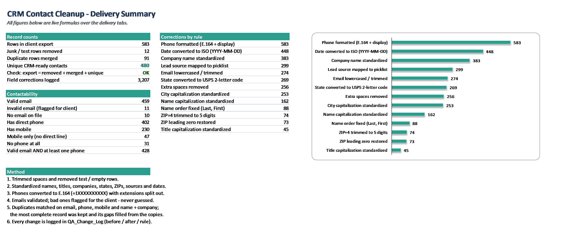
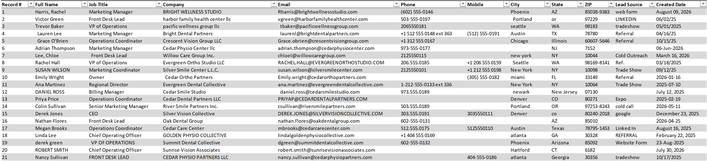
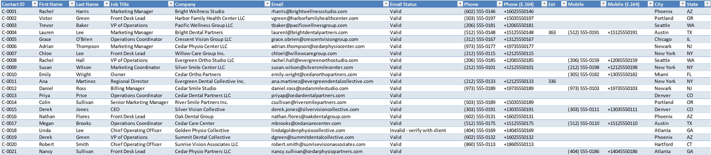
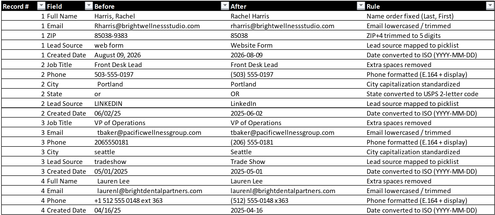
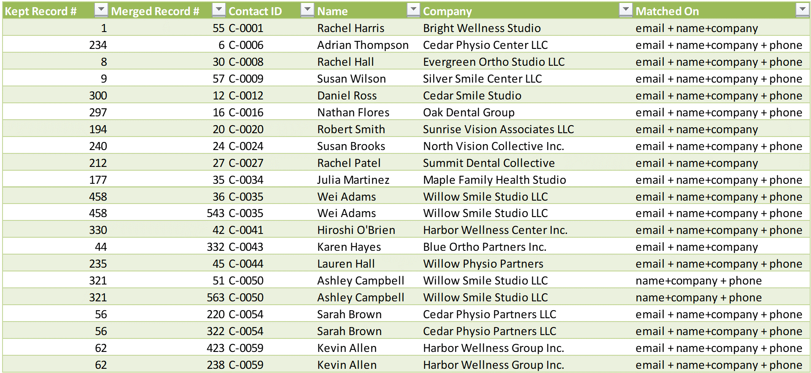

# CRM Contact Cleanup & De-duplication



**Goal:** a contact export pulled from email, web forms and old spreadsheets had to go into a CRM
without duplicates or broken fields.

| Rows in | Junk rows removed | Duplicates merged | CRM-ready contacts | Edits logged |
|---:|---:|---:|---:|---:|
| 583 | 12 | 91 | 480 | 3,207 |

## The mess
- Phones in 6 formats, some with extensions
- "Last, First" names, ALL CAPS, stray spaces
- States written as "Illinois", "Ill." or "il"; ZIP codes missing the leading zero
- The same person entered two or three times
- Test rows and unusable emails

## What I did
- Standardized names, job titles, companies, states (USPS codes), ZIPs, lead sources and dates
- Converted phones to E.164 (`+1XXXXXXXXXX`) for dialers and CRMs
- Matched duplicates on email, phone and name + company; kept the most complete record and filled its gaps
- Flagged 11 invalid emails for review instead of guessing
- Removed 12 junk/test rows and listed each one with the reason

## Files
| File | What it is |
|---|---|
| [`data/raw_contacts_export.csv`](data/raw_contacts_export.csv) | The export as received |
| [`data/crm_ready_contacts.csv`](data/crm_ready_contacts.csv) | UTF-8 CSV ready to import |
| [`data/CRM_Contact_Cleanup_Delivery.xlsx`](data/CRM_Contact_Cleanup_Delivery.xlsx) | Summary, clean list, raw export, duplicate log, junk log, QA change log, data dictionary |
| [`scripts/crm_cleanup_pipeline.py`](scripts/crm_cleanup_pipeline.py) | The repeatable cleanup (pandas + openpyxl) |

The Summary tab is built with live formulas and proves that rows in = rows removed + rows merged + contacts kept.

## Run it again
```
pip install pandas openpyxl
python scripts/crm_cleanup_pipeline.py data/raw_contacts_export.csv data
```

## Before and after
**Raw export**


**Clean contacts**


**QA change log (every edit, before and after)**


**Duplicates merged**

