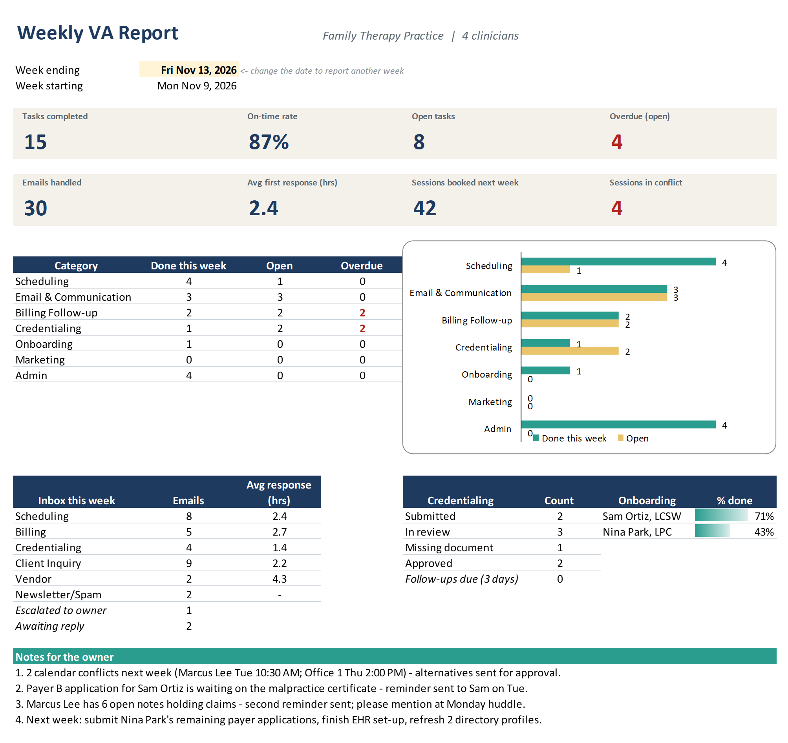
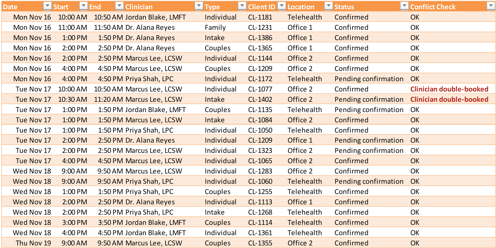
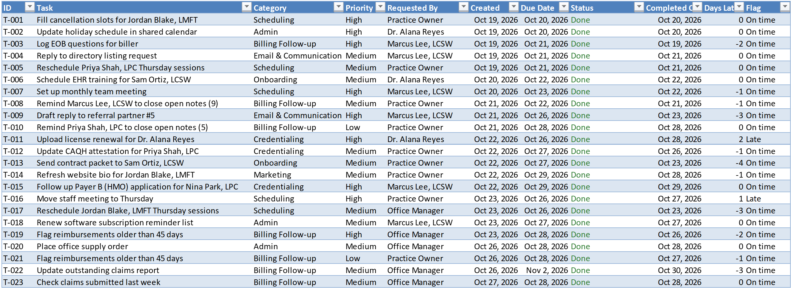
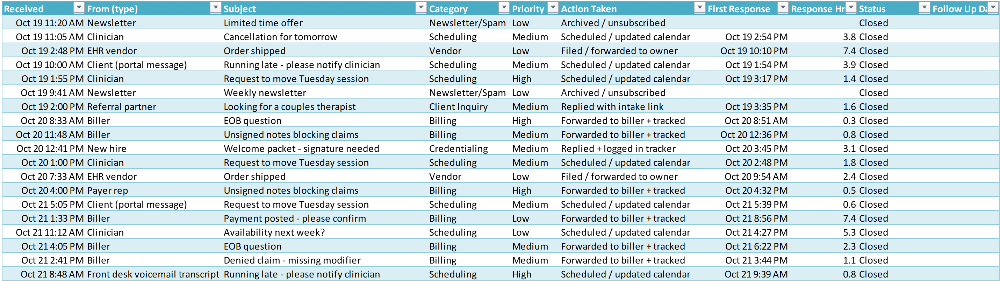
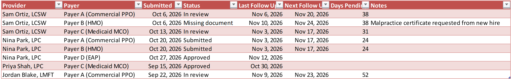
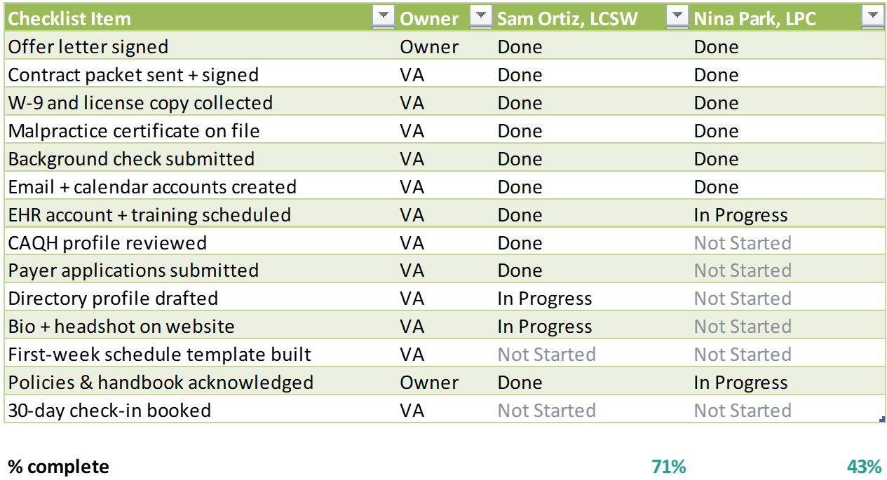

# Virtual Assistant Admin Toolkit & Weekly Report

Admin system designed for a small therapy practice: one place to track requests, email, scheduling,
new-hire onboarding and insurance credentialing, plus a Friday report the owner can read in two minutes.

| Tasks done | On time | Emails handled | Avg first response | Sessions next week | Conflicts caught |
|---:|---:|---:|---:|---:|---:|
| 15 | 87% | 30 | 2.4 h | 42 | 2 |

## What's inside
| File | What it is |
|---|---|
| [`VA_Operations_Toolkit.xlsx`](VA_Operations_Toolkit.xlsx) | Weekly_Report, Task_Tracker, Inbox_Triage, Calendar_Next_Week, Onboarding, Credentialing and How_To_Use tabs |
| [`SOP-VA-01_Inbox_and_Calendar.pdf`](SOP-VA-01_Inbox_and_Calendar.pdf) ([.docx](SOP-VA-01_Inbox_and_Calendar.docx)) | 2-page SOP: daily rhythm, triage rules, inbox labels, calendar rules, privacy, end-of-day checklist |
| [`Weekly_Status_Report_2026-11-13.pdf`](Weekly_Status_Report_2026-11-13.pdf) ([.docx](Weekly_Status_Report_2026-11-13.docx)) | Friday report: decisions needed first, then done, overdue and next week |

## How it runs
- Change the *Week ending* date and every number and chart on the report recalculates
- The task tracker flags overdue items on its own (days late + flag formulas)
- The calendar check marks double-booked clinicians and rooms before anyone is confirmed
- Credentialing follow-ups are scheduled every 14 days with days pending
- Clients appear only as IDs (CL-####); no health information is stored

## Screenshots
**Calendar conflict check**

**Task tracker**

**Inbox triage log**

**Credentialing tracker**

**Onboarding checklist**

