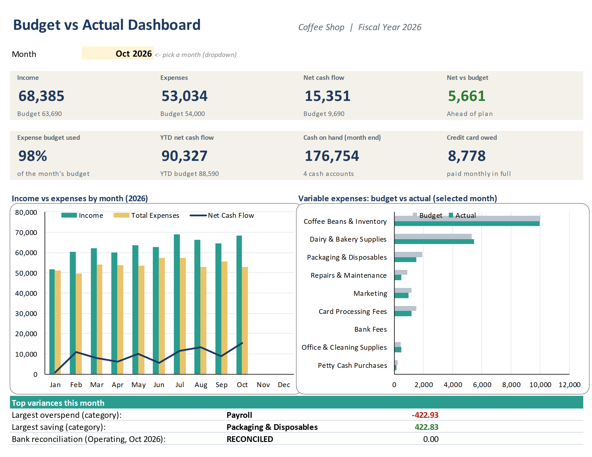
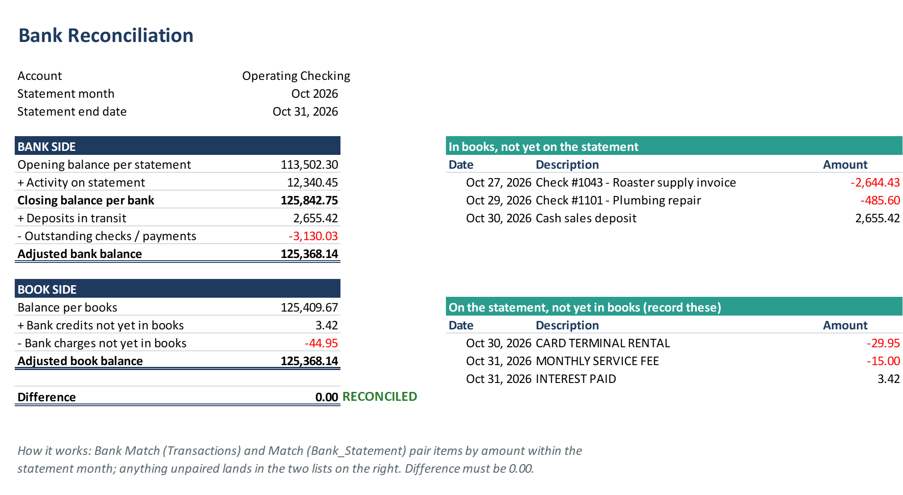
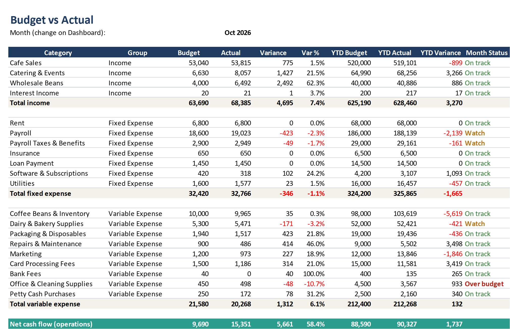
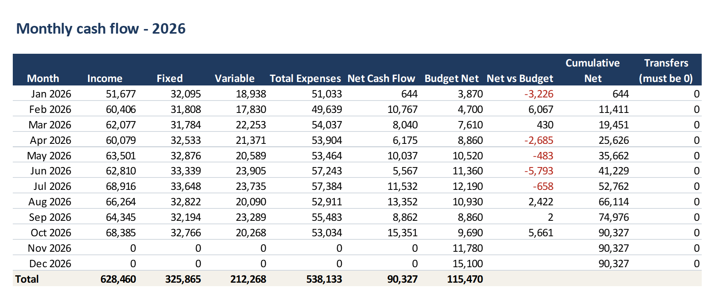
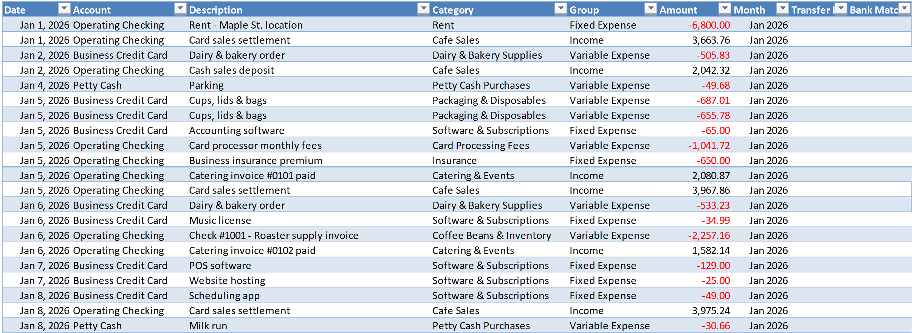

# Budget vs Actual + Bank Reconciliation (Excel, no macros)



Monthly budget-vs-actual workbook designed for a café with 3 bank accounts, a credit card and petty cash.
Pick a month and the dashboard, variances and year-to-date figures update. It runs on older desktop Excel:
classic formulas only (SUMIFS, INDEX/MATCH, IFERROR, SUMPRODUCT), Tables and dropdowns, no VBA, no XLOOKUP.

| Transactions | Accounts | Oct income | Oct expenses | Reconciliation difference |
|---:|---:|---:|---:|---:|
| 704 | 5 | 68,385.20 | 53,034.26 | 0.00 |

## Tabs
| Tab | Purpose |
|---|---|
| Dashboard | Month picker, 8 KPI cards, income vs expenses chart, variable expenses budget vs actual, top variances |
| Transactions | One row per movement; category and account dropdowns; group and month fill automatically |
| Budget | One row per category, one column per month |
| Budget_vs_Actual | Month and year-to-date, variance and status (on track / watch / over budget) |
| Monthly_Summary | Income, expenses, net cash flow and a transfer zero-check for every month |
| Account_Balances | Month-end balance for every account |
| Bank_Statement / Bank_Reconciliation | Lists outstanding checks, deposits in transit and bank-only items by itself; adjusted bank = adjusted book |
| Lists / How_To_Use | Categories, accounts and step-by-step instructions |

Transfers between accounts never count as income or expense: the Monthly_Summary check column stays at 0 every month.

## Example formulas
```
Actual      =-SUMIFS(Txn[Amount], Txn[Category], B6, Txn[Month], Dashboard!$C$4)
Budget      =INDEX(Budget!$C$2:$N$21, MATCH(B6, Budget!$A$2:$A$21, 0), MONTH(Dashboard!$C$4))
Bank match  =IF(COUNTIF(Stmt[Amount], F2)>0, "Cleared", "Outstanding")
```

## Screenshots
**Bank reconciliation, October**


**Budget vs actual**


**Monthly summary**


**Transactions**

