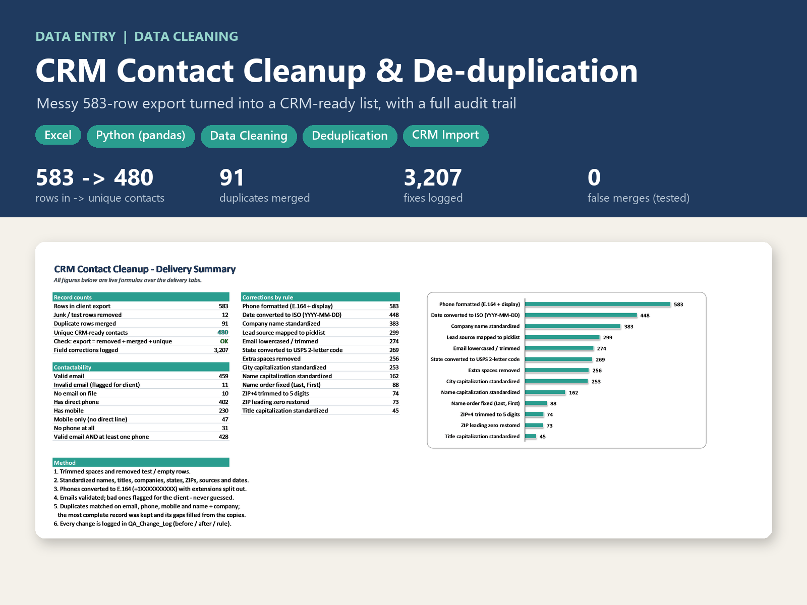
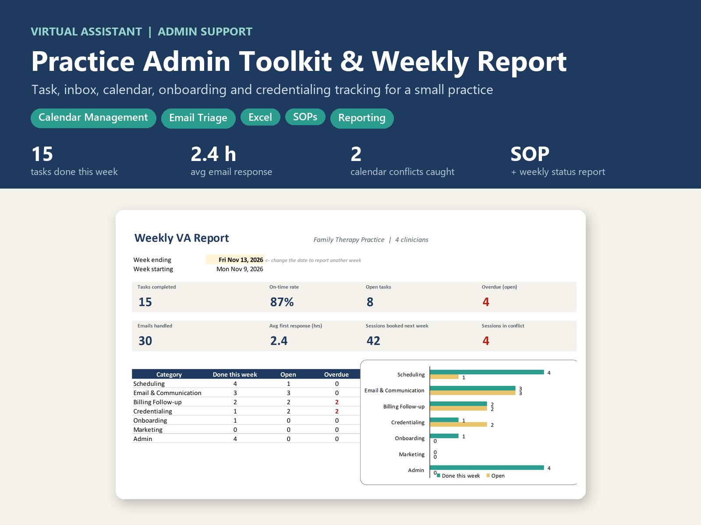
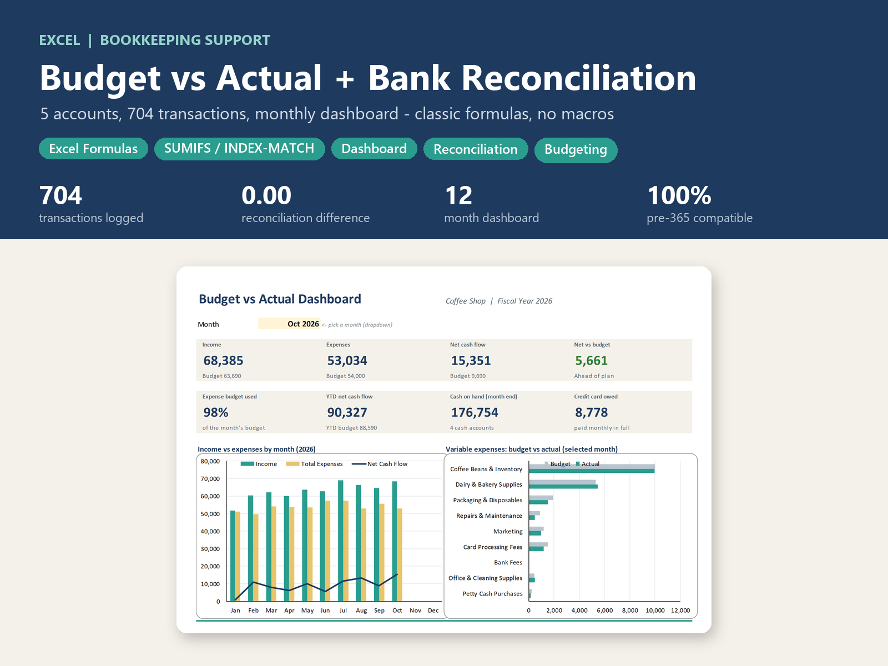

# Data Entry, Virtual Assistant & Excel Portfolio

Three projects built around the work clients post most often: cleaning contact lists for a CRM,
running admin for a busy practice, and Excel budget workbooks that reconcile to the bank.
Every project includes the finished files, so you can open them and see exactly what you would receive.

| | Project | What it shows |
|---|---|---|
|  | **[CRM Contact Cleanup & De-duplication](01-CRM-Data-Cleanup)** | 583 messy rows turned into 480 CRM-ready contacts. 91 duplicates merged, phones in E.164, invalid emails flagged, 3,207 edits logged before/after. |
|  | **[Virtual Assistant Admin Toolkit & Weekly Report](02-VA-Operations-Toolkit)** | Task tracker, inbox triage log, calendar conflict check, onboarding and credentialing trackers, a 2-page SOP and a weekly status report. |
|  | **[Budget vs Actual + Bank Reconciliation](03-Budget-vs-Actual-Reconciliation)** | 704 transactions across 5 accounts, a month picker dashboard and a bank reconciliation that ties to 0.00. Classic formulas only, no macros. |

## How I work

- **Every change logged:** before, after and the rule applied, so the work can be audited.
- **No guessing:** missing or invalid data is flagged for you, never invented.
- **Checked against totals:** counts and balances tie out before anything is delivered.
- **Easy to hand over:** dropdowns, plain formulas and a how-to tab in every workbook.

## Tools

Microsoft Excel (SUMIFS, INDEX/MATCH, SUMPRODUCT, Tables, data validation, conditional formatting, charts),
Python (pandas, openpyxl), Word, CSV/CRM imports.

More work: [International Payments Analytics with SQL Server + Power BI](https://github.com/BryanAndresR23/Portafolio-SQL-PowerBI).

---
Privacy: no client data is published in this repository. Names, emails, phone numbers (US 555-01xx range)
and amounts in these files were generated for public display.
